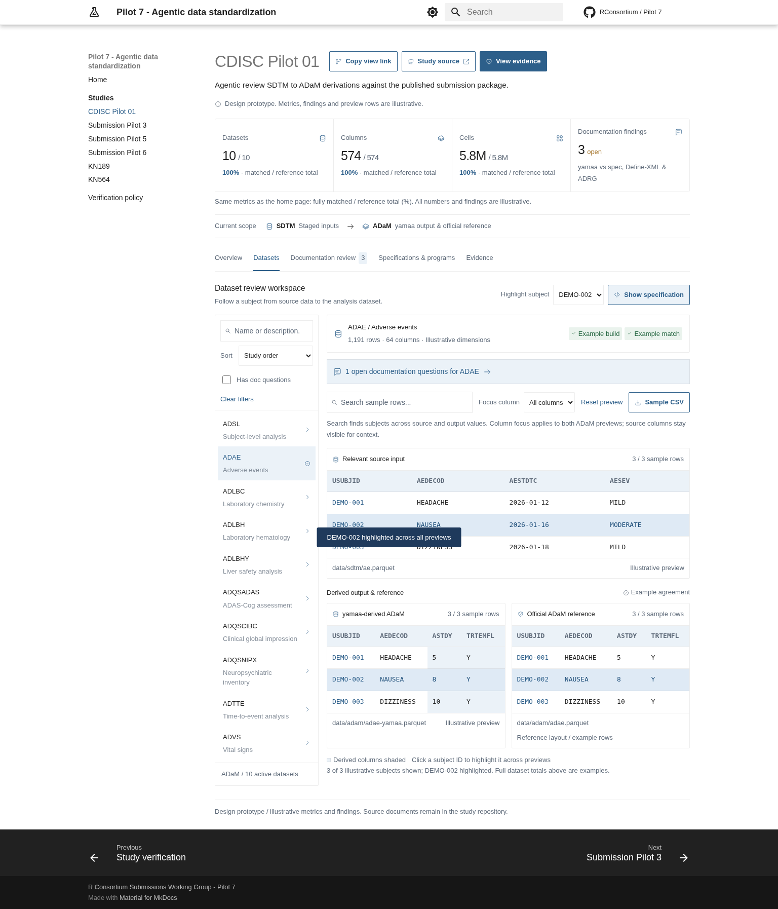
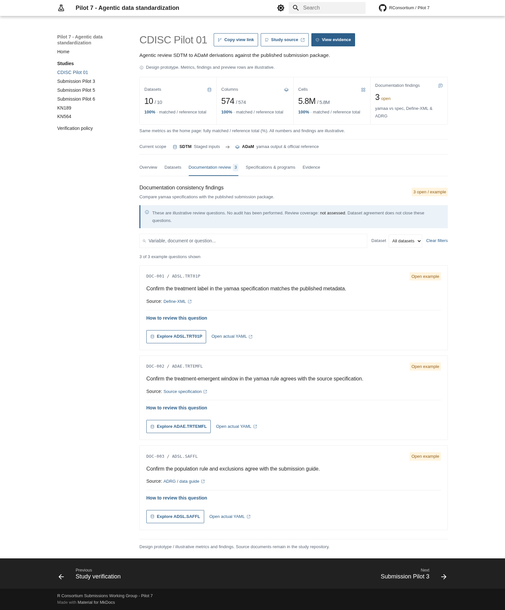
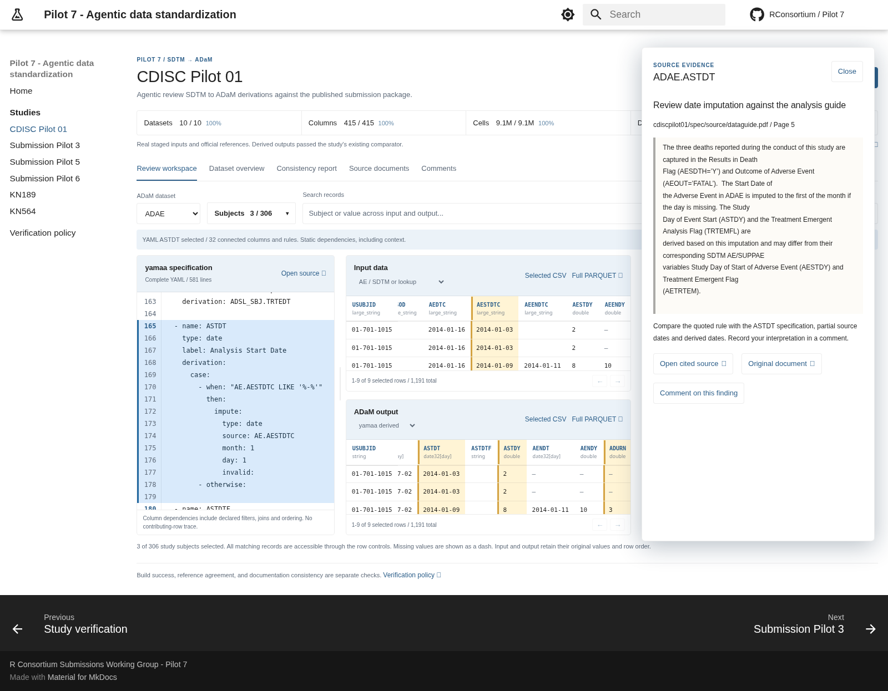

# Static study review workspace

This PR builds a static MkDocs review workspace from the repository's actual
study data, complete yamaa specifications, source documents, and fresh
validation records. It remains an isolated preview: the production study-page
generator and its publication safeguards are unchanged.

## Review experience

- CDISC Pilot 01 and Submission Pilots 3 and 5 have complete input datasets,
  derived outputs, and independent official references. The study's pinned
  yamaa engine and existing comparator must pass before export.
- A searchable subject multi-select initially selects the first three sorted
  study subject IDs. Select any number, including all subjects. Selection is
  shared across input and output; subjects without records remain explicit.
- All matching records are accessible, in original order, through 40-row page
  controls. Selected CSV exports include every matching row, independent of
  the visible page. Complete Parquet/CSV downloads are also available.
- The complete line-numbered specification stays beside input and output
  panes in a desktop viewport. Each pane scrolls independently. A divider
  supports mouse dragging and keyboard arrows. Small screens stack the panes.
- Selecting input/output columns or a YAML block highlights connected rules
  and columns. The index follows declared expressions, intermediate lookups,
  row templates, filters, joins, grouping keys, and ordering context. It is
  conservative static column lineage, not proof of contributing rows.
- The consistency report checks output presence and exact variable labels
  against published Define-XML 1.0/2.0. It also exposes recorded document
  version-alignment questions and source-cited guide review tasks. Narrative
  interpretation is explicitly incomplete, not a passed document audit.
- Findings open the corresponding specification and output column alongside
  a source-evidence drawer. PDF page, workbook sheet/row, and Define-XML item
  reading copies link back to retained originals and upstream provenance.
- Filters, subjects, dataset, selected lineage node, reference choice, and
  evidence drawer are retained in shareable view links.
- Comments use the existing yamaa giscus/GitHub Discussions integration with
  a separate `pilot7/studies/<study>/<dataset>` thread namespace. The page
  labels that host explicitly. GitHub sign-in is required to post. A context
  copier and Pilot 7 issue link remain available when the embed cannot load.
  No comments are posted automatically. `comments.json` owns the destination;
  Pilot 7's own repository currently has no Discussions tab.

## Build and explore

Python >=3.12 and a Rust toolchain are needed for the pinned yamaa package.
From the repository root:

```bash
python -m venv .venv
.venv/bin/python -m pip install -r docs/requirements.txt
.venv/bin/python -m pip install -r cdiscpilot01/program/adam/python/requirements.txt
.venv/bin/python -m pip install -r .github/prototypes/study-dashboard/requirements.txt
export GITHUB_SHA="$(git rev-parse HEAD)"
for study in cdiscpilot01 submission-pilot3 submission-pilot5; do
  .venv/bin/python .github/scripts/validate_yamaa.py "$study" || exit 1
done
.venv/bin/python .github/prototypes/study-dashboard/build_preview.py
.venv/bin/python -m http.server 8765 --directory .build/study-dashboard-preview/site
```

Open <http://localhost:8765/studies/cdiscpilot01/>. The builder refuses missing,
failed, mixed-revision, engine-mismatched, or stale validation evidence.
Generated JSON, reading copies, data chunks, and downloadable artifacts stay
under ignored `.build/`; no generated data is committed to this PR. Derived
Parquet downloads larger than 20 MiB are compressed copies; original study
files and independent references are preserved.

Try selecting `DM.ARM` in the input header: its YAML rules and connected
output treatment columns highlight together. Select `TRT01P` in the output
or its YAML block to follow the relationship in reverse. Use **Subjects ->
Select all** to explore the complete study population. **Consistency report
-> imputation -> Open evidence in workspace** opens the cited guide passage
beside the ASTDT derivation and actual data.

The new interactive hosted preview is recorded in the PR description. The
older `pilot7-study-dashboard-review` hosted design is a previous snapshot.

## Source and evidence boundaries

`review_data.py` exports complete Arrow values in subject-group chunks with
original row ordinals, schemas, and source paths. Data chunks use deterministic
gzip compression and browser-native decompression, keeping the complete static
bundle within hosting limits without a data-serving backend. Subject-independent lookup
relations stay visible. JSON represents non-finite numbers explicitly as
strings, preserving null as a separate missing value; raw downloads retain
original data types. `review_lineage.py` indexes YAML node source spans and
known identifiers, excluding quoted and mapping-dictionary literals.
`review_report.py` retains source citations and checks metadata. Original
clinical data, published references, comparison policies, and source documents
are never modified to obtain agreement.

Automated observations and unfinished review tasks have distinct kinds.
They all require human review; a reference match cannot resolve a narrative
question. A missing lineage relation must not be interpreted as independence.
The report does not assert that every clinical or narrative rule was audited.

## Verification

Run the repository checks from `AGENTS.md`, plus focused export/lineage/report
checks and the repeatable browser checks:

```bash
.venv/bin/python -m unittest discover -s .github/prototypes/study-dashboard -p test_review_data.py -v
.venv/bin/python -m pip install playwright
.venv/bin/python -m playwright install chromium
.venv/bin/python .github/prototypes/study-dashboard/test_browser.py
```

Use `--browser-path /usr/bin/chromium` for an installed browser. Use
`--screenshots .github/prototypes/study-dashboard/screenshots` to refresh
review images. The test owns a temporary local server under a project URL
prefix. It covers arbitrary/all subjects, complete CSV exports, all three
lineage-selection directions, row controls, source evidence, restored views,
clipboard fallback, comments configuration, instant navigation, CSV lookups,
responsive layouts, dark mode, and retryable chunk failures. The test never
posts a comment and does not exercise GitHub sign-in.

Production integration should extend `.github/scripts/build_study_docs.py`,
reuse this artifact format and the existing metrics, and preserve every
publication check. Do not commit generated `docs/studies/` pages. Keep this
PR a draft until the canonical publication path incorporates the workspace.

## Screenshots







[Dataset overview](screenshots/overview.png) /
[Mobile workspace](screenshots/mobile-workspace.png) /
[Dark workspace](screenshots/dark-workspace.png)
