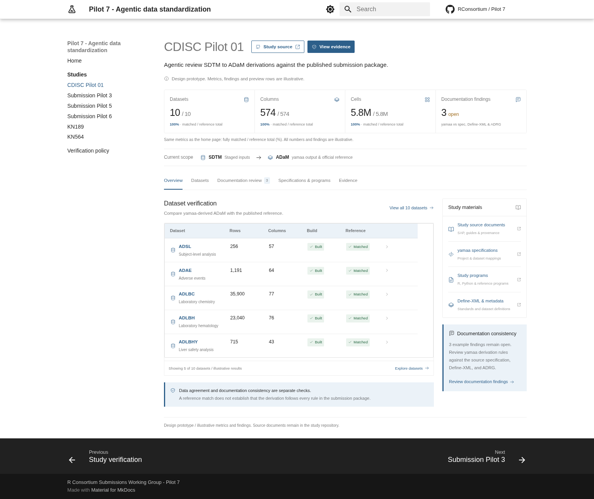

# Study dashboard prototype and implementation handoff

This draft preserves the current visual prototype for another agent to
continue. It does not integrate the dashboard into the published website.
All metrics, dataset dimensions, row previews, and documentation findings
shown by the prototype are illustrative.

The source is self-contained in this folder and builds with the repository's
existing MkDocs Material configuration, stylesheet, navigation conventions,
search, and light/dark palettes. No Sites account or private hosting
credentials are needed to reproduce the prototype.

## User requirements

- Pilot studies cover **SDTM -> ADaM** at this stage. Do not display ODM or
  TLF as pilot pipeline stages.
- Use the description: "Agentic review SDTM to ADaM derivations against the
  published submission package."
- Follow the existing MkDocs layout and styling instead of a separate app
  shell. Keep the white header, blue palette, system fonts, and study
  navigation.
- Place **Study source** and **View evidence** beside the study title to
  save vertical space. They may wrap on narrow screens.
- The first three top-level metrics are **Datasets**, **Columns**, and
  **Cells**, using the home page's fully matched / reference total
  (percentage) definition. `M` means one million.
- The fourth metric counts **documentation consistency findings**, from
  comparing yamaa specifications with source specifications, Define-XML,
  ADRG, and other relevant submission documents. The prototype interprets
  this as the number of open findings and links it to the review detail.

## Reproduce the preview

From the repository root, using Python 3.12 or a compatible environment:

```bash
python -m venv .venv
.venv/bin/python -m pip install -r docs/requirements.txt
.venv/bin/python .github/prototypes/study-dashboard/build_preview.py
.venv/bin/python -m http.server 8765 --directory .build/study-dashboard-preview/site
```

Open <http://localhost:8765/studies/cdiscpilot01/>.
The preview-only pages and output are written under the ignored `.build/`
directory. The script reads the real MkDocs configuration and styles, copies
the project home and verification policy, and removes publication hooks in
its staged configuration. It does not edit production Markdown, navigation,
the study catalog, validation evidence, or reference datasets.

The owner-private hosted review copy is
<https://pilot7-study-dashboard-review.yamaa-2308.chatgpt.site/studies/cdiscpilot01/>.
Use the local build and screenshots when that private site is inaccessible.

## What is implemented

- Study overview with the four requested metrics and two-stage pilot scope.
- Dataset browser with search, dataset selection, linked subject highlighting,
  source/derived/reference previews, and a collapsible specification panel.
- Documentation review with three example questions, source links, and an
  explicit statement that no document audit has been performed.
- Links to specifications, programs, source documents, and validation
  workflows; sample evidence download.
- Responsive layouts and support for Material's dark palette and instant
  page navigation.

The sample state is embedded in `dashboard.js`. The `3` open findings,
`100%` agreement, and preview rows are examples, not measured results. Pending
studies display "Not reviewed" rather than a false zero findings count.
Pilot 6 appears only as a pending example in this isolated preview; the
production catalog and current decision to hide it remain unchanged.

## Continue implementation

1. Keep the existing study page generator as the publication owner. Integrate
   the layout through `.github/scripts/build_study_docs.py` rather than
   committing generated `docs/studies/` pages. Extend the current templates
   and owned assets instead of maintaining a second production generator.
2. Replace the embedded sample catalog and dimensions with existing study
   metadata, project specifications, and current-run validation reports.
   Reuse the home page's metric definitions in
   `.github/scripts/build_index_table.py`. In particular, reference
   denominators come from independent official reference files, not derived
   output sizes.
3. Implement the documentation-consistency review and persist structured
   findings. Record dataset/variable, document path and section, the yamaa
   rule, the discrepancy, evidence, and review resolution. Agree on review
   coverage and finding states; the current count means open findings.
   Missing documents or unrun checks must remain visible as incomplete
   coverage, not count as zero findings or a passed review.
4. Populate the findings view and count from that evidence. Link to exact
   document sections and specification locations where possible. The three
   questions in this prototype do not identify verified defects in the
   actual studies.
5. Build bounded dataset previews from the validated artifacts; retain
   independent official references and explicit row/column totals. Replace
   the abbreviated YAML sample with the real specification.
6. Preserve current publication checks against failed builds, missing
   records, mixed source commits, and engine-pin mismatches. Keep build
   success, official comparison, and documentation consistency distinct.
7. Add focused tests at the existing evidence/generator boundaries and run
   the website validation workflow required by `AGENTS.md` before enabling
   production output. Keep this PR a draft until that integration is ready.

No actual documentation review, new derivation run, or production dashboard
integration has been completed by this prototype.

## Preview verification

The saved prototype passed a strict MkDocs build and browser checks for:
legacy-link redirect, native MkDocs shell, exact description, title actions,
four metrics, two-stage pilot scope, findings links, instant study navigation,
dataset selection/search, subject highlighting, specification toggling,
sample evidence download, narrow layouts, and dark mode.

The repository copy should also pass the shared ASCII, structure, unittest,
and whitespace checks. Study engine execution is not needed to render this
isolated design preview and does not follow from its sample success states.

## Screenshots




